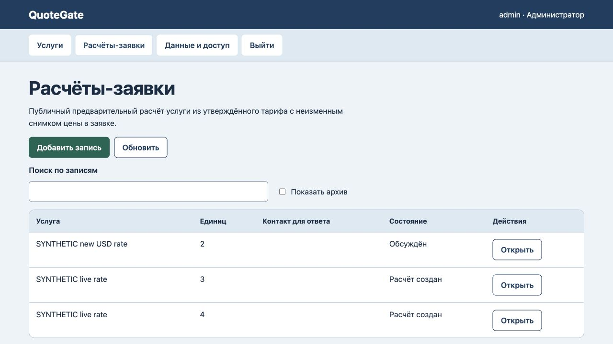
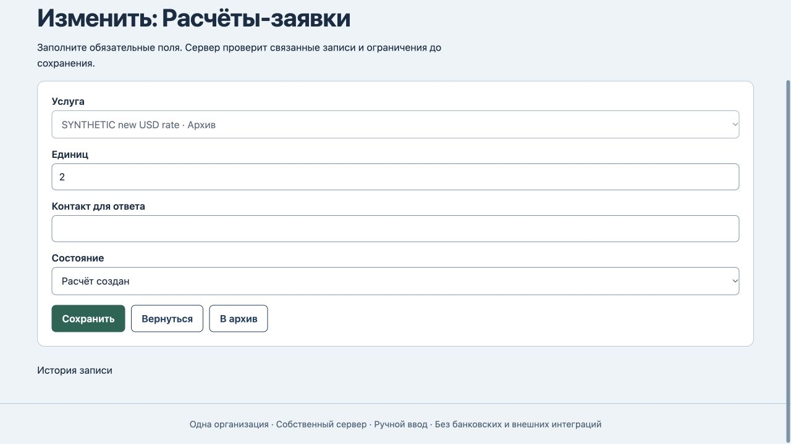

# QuoteGate: архив услуги и снимок цены

25 октября2026. На прежнем коде авторизованный API создавал новый расчёт по архивной published-услуге,хотя публичная ссылка была закрыта. Редактор прежнего расчёта терял архивную услугу в обязательном поле и не давал сохранить статус. Две регрессионные проверки сначала упали.

Теперь новый расчёт требует неархивной опубликованной услуги. В прежнем расчёте текущая архивная услуга остаётся выбранной с пометкой «Архив»;услуга,количество и контакт доступны только для чтения,как уже требовал сервер. Новая форма остаётся редактируемой и не предлагает архивы. Схема хранения прежняя.

Сохранение снимка уже работало:отдельная проверка старой цены/перезапуска/восстановления прошла ещё на baseline. Исходные250 KZT и полный снимок остаются прежними после смены тарифа на7 USD,фиксированной части на1 USD и диапазона до1 единицы,затем архива. Статус можно изменить без пересчёта.

Все8 тестов прошли.8 HTTP400 отказов сохранили данные/версию8/журнал8:3 новых ограничения архива и5 прежних проверок неизменности/закрытого публичного маршрута. Браузер сохранил статус старого расчёта,принял новый публичный расчёт340 KZT по действующей услуге,отклонил архивную ссылку. Reload:3 расчёта,прежние250/260 KZT и снимки неизменны,версия10/журнал10. [Машинная проверка](archive-verification.json).

Основной сервер перезапущен после проверки владения,18 сохранённых состояний/версий/журналов не изменились. Предварительная сумма и ручной статус «Обсуждён» не доказывают заказ,договор,платёж или фактическое обсуждение с клиентом. Налоговые/договорные условия согласуются отдельно. Промышленного размещения,клиентской приёмки и нового полного аудита интерфейса/безопасности нет.
